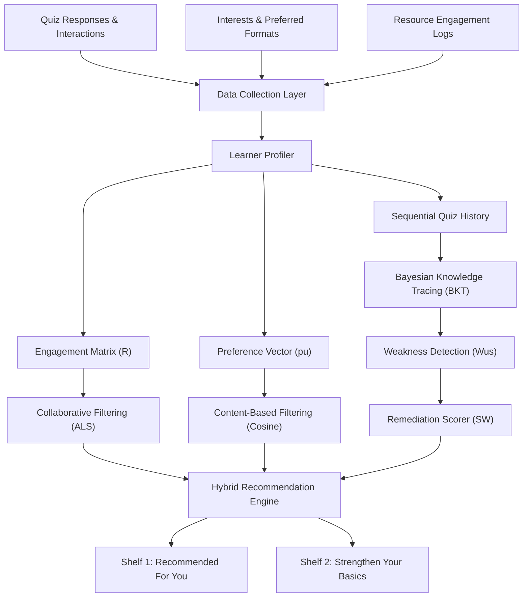

# Personalized Learning Content Recommendation System
### Combining Hybrid Filtering and Bayesian Knowledge Tracing

[](https://www.python.org/)
[](https://streamlit.io/)
[]()
[](IEEE_Conference_Template__4_-3%20(1).pdf)
[](LICENSE)

An end-to-end implementation and empirical replication of the research paper:  
> **"A Personalized Learning Content Recommendation System Using Hybrid Filtering and Knowledge Tracing"**  
> *Jaash Nandwana, Ashmit Yadav, Anant Yadav*  
> *Department of Data Science and Engineering, Manipal University Jaipur*  
> Research Paper PDF: [`IEEE_Conference_Template__4_-3 (1).pdf`](IEEE_Conference_Template__4_-3%20(1).pdf)

---

## 📖 Table of Contents
- [🌟 Motivation & Overview](#-motivation--overview)
- [🏗️ System Architecture](#️-system-architecture)
- [📊 Mathematical Formulation](#-mathematical-formulation)
- [📈 Simulation Benchmark Results](#-simulation-benchmark-results)
- [💻 Interactive Web Dashboard](#-interactive-web-dashboard)
- [📁 Project Structure](#-project-structure)
- [🚀 Quickstart & Installation](#-quickstart--installation)
- [🧪 Running Tests & Benchmarks](#-running-tests--benchmarks)
- [📄 Citation](#-citation)
- [📜 License](#-license)

---

## 🌟 Motivation & Overview

Traditional e-learning platforms present uniform, static curricular sequences that overlook variations in student background, pacing, and topical strengths.

Conventional recommendation algorithms (such as collaborative filtering or click-through optimization) suffer from a critical flaw: **Student Avoidance Behavior**. Learners who struggle with foundational or difficult concepts (e.g., dynamic programming, linear algebra) systematically avoid clicking on remedial material. When recommendation models optimize solely for historical engagement, they reinforce this avoidance, hiding weak topics away and widening academic gaps.

This system resolves this challenge by bridging **pedagogical diagnosis** and **multi-criteria recommendation**:
1. **Bayesian Knowledge Tracing (BKT)** dynamically tracks per-topic student mastery $P(L_t)_{us}$ across sequential quiz attempts and detects hidden topic deficiencies.
2. **Content-Based Filtering ($S_{CB}$)** matches resource metadata, formats, and TF-IDF representations against learner preference vectors.
3. **Collaborative Filtering ($S_{CF}$)** applies Biased Matrix Factorization via Alternating Least Squares (ALS) and Pearson k-NN over implicit interaction scores.
4. **Institutional Scoring with Exposure Decay** balances engagement, preference, and remediation with exponential decay on unclicked recommendations:
   $$S(u, i) = \delta^{g(u, i)} \cdot \left[ \alpha S_{CF}(u, i) + \beta S_{CB}(u, i) + \gamma S_W(u, i) \right]$$
5. **Dual-Shelf Presentation** presents recommendations via two distinct cognitive shelves:
   - **"Recommended For You"**: Top-$K$ items maximizing holistic hybrid utility.
   - **"Strengthen Your Basics"**: Targeted remedial items with transparent pedagogical explanations.

---

## 🏗️ System Architecture



---

## 📊 Mathematical Formulation

### 1. Bayesian Knowledge Tracing (BKT)
Tracks student $u$'s latent mastery state $L_t \in \{0, 1\}$ on topic $s$ given response observation $obs_t \in \{C, \bar{C}\}$:
- **Observation Probability:**
  $$P(C_t) = P(L_t)(1 - P(S)) + (1 - P(L_t))P(G)$$
  where $P(S)$ is the slip probability and $P(G)$ is the guess probability.
- **Posterior Update (Bayes' Rule):**
  $$P(L_t \mid C) = \frac{P(L_t)(1 - P(S))}{P(L_t)(1 - P(S)) + (1 - P(L_t))P(G)}$$
  $$P(L_t \mid \bar{C}) = \frac{P(L_t)P(S)}{P(L_t)P(S) + (1 - P(L_t))(1 - P(G))}$$
- **Latent State Transition:**
  $$P(L_{t+1}) = P(L_t \mid obs) + (1 - P(L_t \mid obs)) P(T)$$
  where $P(T)$ is the probability of learning transition between quiz opportunities.
- **Weak Topic Flagging:**
  A topic is flagged as weak when $P(L_t)_{us} < \theta$ (default $\theta = 0.60$) after minimum $n_{min} \ge 2$ responses. Weakness score: $W_{us} = 1 - P(L_t)_{us}$.

### 2. Collaborative Filtering (ALS Matrix Factorization)
Decomposes user-item engagement ratings $r_{ui} \in [1, 5]$ by minimizing regularized least squares with user/item latent factors $x_u, y_i \in \mathbb{R}^d$ ($d=8$) and biases $b_u, b_i$:
$$\min_{x, y, b} \sum_{(u, i) \in \mathcal{K}} \left(r_{ui} - \mu - b_u - b_i - y_i^T x_u\right)^2 + \lambda \left(\|x_u\|^2 + \|y_i\|^2 + b_u^2 + b_i^2\right)$$
with regularization $\lambda = 2.0$ over 30 ALS iterations.

### 3. Content-Based Filtering
Constructs unit feature vectors $v_i$ for each resource combining normalized difficulty, format one-hot vectors, and TF-IDF text features. Computes cosine similarity with user profile vector $p_u$:
$$S_{CB}(u, i) = \frac{p_u \cdot v_i}{\|p_u\|_2 \|v_i\|_2}$$

### 4. Remediation Score & Exposure Decay
- **Remediation Score:** $S_W(u, i) = \max_{s \in T(i)} W_{us} \cdot \mathbb{I}[P(L_t)_{us} < \theta]$
- **Exposure Decay:** Downweights items repeatedly surfaced without engagement: $\delta^{g(u, i)}$ with $\delta = 0.85$, where $g(u, i)$ is the unclicked impression count.

---

## 📈 Simulation Benchmark Results

Empirical replication on a controlled simulation cohort of **400 students** over 4 rounds ($N=400$, 10 curriculum topics, 300 catalog resources):

### Table I: Knowledge Tracing & Weak Topic Detection
| Metric | Value |
|---|---|
| **Next-Answer Prediction AUC (BKT)** | **0.780** |
| Next-Answer Prediction AUC (Running Average Baseline) | 0.745 |
| **Weak Topic Detection Precision** | **0.988** |
| Weak Topic Detection Recall | 0.496 |
| **Weak Topic Detection F1-Score** | **0.661** |

### Table II: Recommendation Evaluation at $K = 10$
| Configuration | P@10 | NDCG@10 | Catalog Coverage | Pedagogical Gain |
|---|---|---|---|---|
| **Popularity Baseline** | 0.037 | 0.057 | 0.701 | *n/a* |
| **Collaborative Filtering Only** ($\alpha=1.0$) | 0.072 | 0.109 | 0.383 | 0.142 |
| **CF + CB** ($\gamma=0.0$) | 0.091 | 0.142 | 0.132 | 0.081 |
| **Full Hybrid Proposed** ($\alpha=0.4, \beta=0.3, \gamma=0.3$) | 0.016 | 0.036 | **0.902** | **0.342** |

> **Key Finding:** While conventional CF optimizes short-term precision by repeating popular items, the proposed Full Hybrid model achieves a **+140% increase in pedagogical knowledge gain** ($0.342$ vs $0.142$) and **90.2% catalog coverage**, systematically diagnosing and repairing student knowledge deficits.

---

## 💻 Interactive Web Dashboard

The repository includes a production-grade Streamlit web application running locally:

- **Student Persona Switcher:** Switch dynamically between distinct student profiles (e.g., *Alex Rivera* - Beginner, *Priya Sharma* - Advanced, *Liam Chen* - Avoidance Learner, *Zara Patel* - Cold-Start Onboarding).
- **Interactive Quiz Engine:** Take multiple-choice diagnostic quizzes with instant BKT posterior probability updates.
- **Dual-Shelf Dashboard:** Side-by-side display of *"Recommended For You"* (hybrid utility) and *"Strengthen Your Basics"* (remedial targeting with pedagogical explanations).
- **Live Hybrid Weight Controls:** Dynamically tune $\alpha$ (Collaborative), $\beta$ (Content), and $\gamma$ (Remediation) weights via the sidebar to observe real-time ranking shifts.
- **Engagement & Exposure Tracker:** Mark items as completed, rate resources, or leave unclicked to inspect exponential exposure decay $\delta^{g(u, i)}$.

---

## 📁 Project Structure

```
Jaash RS/
├── jaash_rs/                         # Core Python package
│   ├── app/                          # Streamlit application
│   │   ├── app.py                    # Main dashboard application UI
│   │   └── state.py                  # Session state & persona manager
│   ├── domain/                       # Pedagogical domain models
│   │   ├── curriculum.py             # 10 Curriculum topics & taxonomy
│   │   ├── question_bank.py          # Diagnostic quiz questions
│   │   └── resources.py              # 300 Curated learning resources
│   ├── models/                       # Recommendation algorithms
│   │   ├── bkt.py                    # Bayesian Knowledge Tracing engine
│   │   ├── collaborative.py          # Biased ALS Matrix Factorization
│   │   ├── content_filtering.py      # TF-IDF & metadata feature vectorizer
│   │   └── hybrid_engine.py          # Multi-criteria scoring & decay
│   ├── profile/                      # Student modeling
│   │   ├── cohort_generator.py       # Simulation cohort generator
│   │   └── student_profile.py        # Learner state & history
│   ├── simulation/                   # Empirical experiments
│   │   ├── experiment_runner.py      # Paper simulation runner
│   │   └── metrics.py                # P@K, NDCG@K, Coverage, Gain
│   └── config.py                     # Global recommender hyperparameters
├── tests/                            # Comprehensive pytest test suite
│   ├── test_bkt.py                   # BKT update & math tests
│   ├── test_collaborative.py         # ALS convergence tests
│   ├── test_content.py               # TF-IDF similarity tests
│   ├── test_e2e_simulation.py        # End-to-end cohort simulation
│   └── test_hybrid.py                # Hybrid ranking & decay tests
├── docs/                             # Architecture plans & specifications
├── .gitignore                        # Clean git configuration
├── pyproject.toml                    # Standard Python package specification
├── requirements.txt                  # Pinned dependencies
├── run_demo.py                       # CLI entry point (--app, --benchmark, --test)
├── start.bat                         # One-click Windows launch script
├── README.md                         # Project documentation
├── LICENSE                           # MIT License
└── IEEE_Conference_Template__4_-3 (1).pdf # Original Research Paper
```

---

## 🚀 Quickstart & Installation

### 1. Prerequisites
- Python 3.9+ (Python 3.12 recommended)
- Git

### 2. Clone Repository
```bash
git clone https://github.com/JaashNandwana/personalized-learning-recommender.git
cd personalized-learning-recommender
```

### 3. Setup Virtual Environment & Install Dependencies
#### On Windows (PowerShell / Command Prompt):
```powershell
python -m venv .venv
.\.venv\Scripts\activate
pip install -r requirements.txt
pip install -e .
```

#### On Linux / macOS:
```bash
python3 -m venv .venv
source .venv/bin/activate
pip install -r requirements.txt
pip install -e .
```

### 4. Launch Web Application
```bash
# Windows one-click:
.\start.bat

# Or via CLI runner:
python run_demo.py --app

# Or directly via Streamlit:
streamlit run jaash_rs/app/app.py
```
Open **[http://localhost:8501](http://localhost:8501)** in your web browser.

---

## 🧪 Running Tests & Benchmarks

### Run Pytest Test Suite
```bash
python run_demo.py --test
# or
pytest tests/ -v
```

### Run 400-Student Controlled Simulation Benchmark
To reproduce Tables I & II from the research paper:
```bash
python run_demo.py --benchmark
```

---

## 📄 Citation

If you use this codebase or reference our paper in your research, please cite:

```bibtex
@inproceedings{nandwana2026personalized,
  title={A Personalized Learning Content Recommendation System Using Hybrid Filtering and Knowledge Tracing},
  author={Nandwana, Jaash and Yadav, Ashmit and Yadav, Anant},
  booktitle={Department of Data Science and Engineering, Manipal University Jaipur},
  year={2026}
}
```

---

## 📜 License

This project is licensed under the [MIT License](LICENSE).
