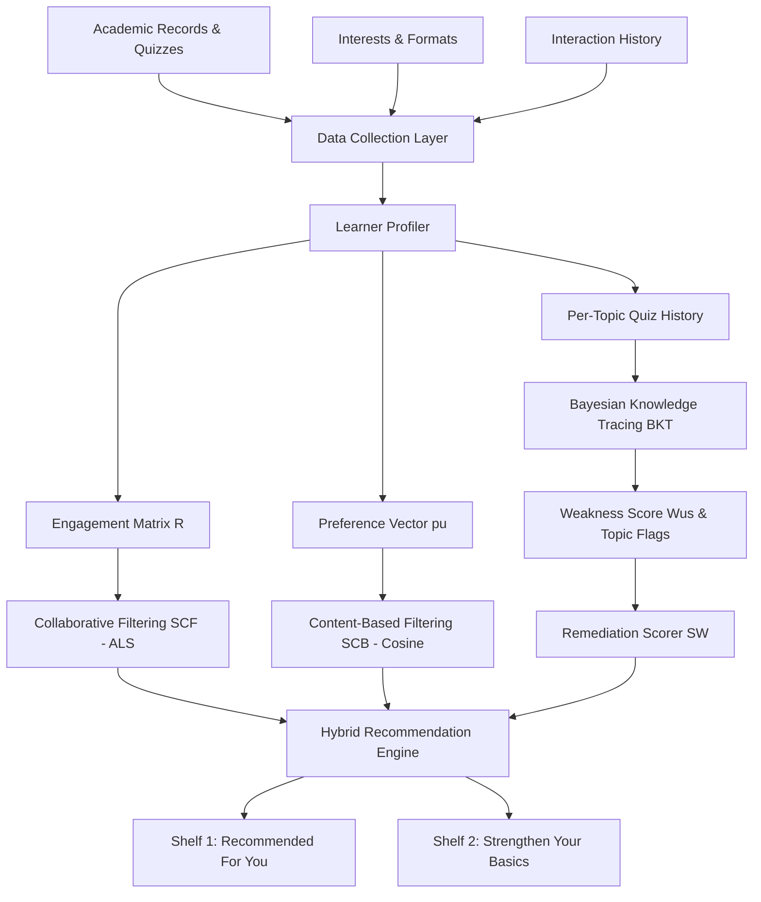

# Personalized Learning Content Recommendation System
### Combining Hybrid Filtering and Bayesian Knowledge Tracing

Based on the research paper:  
**"A Personalized Learning Content Recommendation System Using Hybrid Filtering and Knowledge Tracing"**  
*Jaash Nandwana, Ashmit Yadav, Anant Yadav* — Department of Data Science and Engineering, Manipal University Jaipur.

---

## 🌟 Overview & Key Motivation
Traditional e-learning platforms present the same static learning sequence to all students, ignoring their performance, interests, and learning speed.

Conventional recommendation systems (e.g. click-based collaborative filtering or preference matching) suffer from a critical pedagogical flaw: **Student Avoidance Behavior**. Students weak in a subject (e.g., algorithms or linear algebra) rarely click on that subject by choice. A system trained strictly on historical engagement learns to hide those topics away, worsening learning gaps.

This system resolves this problem by combining:
1. **Bayesian Knowledge Tracing (BKT)**: Dynamically estimates per-topic mastery $P(L_t)_{us}$ and flags weak topics ($W_{us} = 1 - P(L_t)_{us}$).
2. **Content-Based Filtering ($S_{CB}$)**: Feature vectorization over resource difficulty, format, and TF-IDF text descriptions against student preference vectors $p_u$.
3. **Collaborative Filtering ($S_{CF}$)**: Biased Matrix Factorization via Alternating Least Squares (ALS) and Pearson correlation k-NN over implicit engagement scores $r_{ui} \in [1, 5]$.
4. **Institutional Scoring with Exposure Decay**:
   $$S(u, i) = \delta^{g(u, i)} \cdot \left[ \alpha S_{CF}(u, i) + \beta S_{CB}(u, i) + \gamma S_W(u, i) \right]$$
5. **Dual-Shelf Presentation**:
   - **"Recommended for you"**: Top-$K$ items by hybrid score $S(u, i)$.
   - **"Strengthen your basics"**: Top-$K$ items targeting weak topics ($S_W > 0$) with transparent pedagogical explanations.

---

## 🏗️ System Architecture



---

## 🚀 Quickstart & Usage

### 1. Run All Unit & Integration Tests
```bash
python3 -m pytest tests/
# or
python3 run_demo.py --test
```

### 2. Launch Interactive Streamlit Web Application
```bash
streamlit run jaash_rs/app/app.py
# or
python3 run_demo.py --app
```
Then open [http://localhost:8501](http://localhost:8501) in your browser.

### 3. Run Controlled Simulation Benchmark (400 Students)
To reproduce the paper's experiments (Table I & Table II):
```bash
python3 run_demo.py --benchmark
```

---

## 📊 Modules & Formulation Reference

### 1. Bayesian Knowledge Tracing (BKT)
- **Chance of correct answer:**
  $$P(C_t) = P(L_t)(1 - P(S)) + (1 - P(L_t))P(G)$$
- **Bayes' Rule posterior update:**
  $$P(L_t \mid C) = \frac{P(L_t)(1 - P(S))}{P(L_t)(1 - P(S)) + (1 - P(L_t))P(G)}$$
  $$P(L_t \mid \bar{C}) = \frac{P(L_t)P(S)}{P(L_t)P(S) + (1 - P(L_t))(1 - P(G))}$$
- **Transition update:**
  $$P(L_{t+1}) = P(L_t \mid \text{obs}) + (1 - P(L_t \mid \text{obs}))P(T)$$
- **Weakness criterion:** Topic $s$ flagged when $P(L_t)_{us} < \theta$ (default $\theta = 0.60$) and $n \ge n_{min}$ ($n_{min} = 2$).

### 2. Collaborative Filtering (ALS Matrix Factorization)
- Minimizes:
  $$\min_{x, y, b} \sum_{(u, i) \in \mathcal{K}} (r_{ui} - \mu - b_u - b_i - y_i^T x_u)^2 + \lambda (\|x_u\|^2 + \|y_i\|^2 + b_u^2 + b_i^2)$$
  with latent dimensions $d=8$, $\lambda=2.0$, and 30 ALS iterations.

### 3. Content-Based Filtering
- Builds normalized TF-IDF and metadata feature vector $v_i$ for each resource.
- Computes student preference vector $p_u$ (engagement-weighted average of completed resources or onboarding profile).
- Content score is cosine similarity: $S_{CB}(u, i) = \frac{p_u \cdot v_i}{\|p_u\| \|v_i\|}$.

### 4. Remediation & Decay
- Remediation score: $S_W(u, i) = \max_{s \in T(i)} W_{us} \cdot \mathbb{I}[P(L_t)_{us} < \theta]$
- Exposure decay: $\delta^{g(u, i)}$ with $\delta = 0.85$, where $g(u, i)$ counts unclicked impressions.
